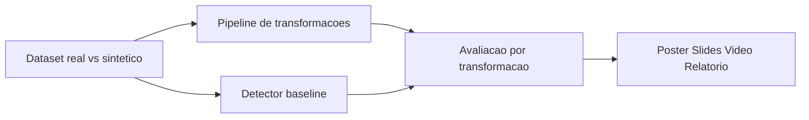

# Detecção de Imagens Sintéticas após Transformações

Trabalho final da disciplina **INE410159 / TRV410001 — Visão Computacional** (UFSC, 2026.2).

---

## Objetivo

Avaliar a **robustez** de detectores de imagens geradas por IA quando essas imagens passam por transformações comuns de compartilhamento digital (compressão, crop, resize, screenshot, filtros etc.).

## Pergunta de pesquisa

> Quão robustos são detectores de imagens sintéticas quando a imagem sofre transformações típicas de circulação na internet?

## Ideia do projeto

Em vez de apenas treinar um classificador "real vs IA", este trabalho é um **experimento científico de robustez**:

1. Obter imagens reais e sintéticas (geradas por IA).
2. Treinar ou usar um detector baseline nas imagens originais.
3. Aplicar transformações sistemáticas em cada imagem.
4. Medir como a performance degrada a cada transformação.

Isso permite discutir **generalização**, **degradação de características** e **limitações do estado da arte** — temas centrais da disciplina.

## Abordagem



| Etapa | O que fazemos |
|---|---|
| Baseline | Medir accuracy/F1/AUC em imagens **sem** transformação |
| Transformações | Aplicar crop, JPEG, resize, blur etc. de forma controlada |
| Comparação | Registrar queda de performance por tipo de transformação |
| Análise | Identificar quais padrões visuais o detector perde após cada transformação |

## Transformações planejadas

| Categoria | Transformações |
|---|---|
| Compressão | JPEG 90%, 70%, 50% |
| Geometria | Resize, crop 10%, 25%, 40% |
| Captura | Screenshot simulado |
| Filtros | Blur, sharpen, brilho/contraste |
| Pipeline | Combinação crop → resize → JPEG |

## Modelos

| Escopo | Descrição |
|---|---|
| **Mínimo** | 1 detector (CNN treinada ou modelo pré-treinado) |
| **Opcional (nota alta)** | Comparar 3 famílias: CNN em pixels, modelo em frequência, CLIP/ViT |

## Entregas

Prazo final: **30/11/2026** (todas as entregas no mesmo dia) · Detalhes em [`Entregas.md`](Entregas.md)

| # | Entrega | Formato | Tarefas |
|---|---|---|---|
| 1 | Relatório | PDF, 10–20 páginas (+ poster anexo) | [`tarefas/01-relatorio.md`](tarefas/01-relatorio.md) |
| 2 | Código | ZIP do GitHub + link dos checkpoints | [`tarefas/02-codigo.md`](tarefas/02-codigo.md) |
| 3 | Slides | PPTX/ODP + Google Slides | [`tarefas/03-slides.md`](tarefas/03-slides.md) |
| 4 | Vídeo | MP4 H.265 FHD + YouTube | [`tarefas/04-video.md`](tarefas/04-video.md) |
| 5 | Poster | PDF A1, 2 colunas | [`tarefas/05-poster.md`](tarefas/05-poster.md) |

Ordem recomendada de execução: **código → poster → slides → vídeo → relatório** (ver [`tarefas/README.md`](tarefas/README.md)).

## Datas importantes

| Data | Marco |
|---|---|
| 30/11/2026 | Entrega de **todas** as 5 atividades no Moodle (relatório, código, slides, vídeo e poster) |

## Regras de IAGen

Se usar IA generativa para código (Copilot, Cursor, ChatGPT etc.):

- Declarar explicitamente o uso.
- Informar qual ferramenta e quais prompts foram usados.
- Explicar o código gerado para demonstrar compreensão.

Registrar em `IAGEN.md` (criar quando aplicável).

## Referências iniciais

- [Raising the Bar of AI-generated Image Detection with CLIP (CVPR 2024)](https://openaccess.thecvf.com/content/CVPR2024W/WMF/papers/Cozzolino_Raising_the_Bar_of_AI-generated_Image_Detection_with_CLIP_CVPRW_2024_paper.pdf)
- [CO-SPY: Combining Semantic and Pixel Features (CVPR 2025)](https://openaccess.thecvf.com/content/CVPR2025/html/Cheng_CO-SPY_Combining_Semantic_and_Pixel_Features_to_Detect_Synthetic_Images_CVPR_2025_paper.html)
- [Bridging the Gap Between Ideal and Real-world Evaluation (ICCV 2025)](https://openaccess.thecvf.com/content/ICCV2025/html/Li_Bridging_the_Gap_Between_Ideal_and_Real-world_Evaluation_Benchmarking_AI-Generated_ICCV_2025_paper.html)
- [NTIRE 2026 Challenge on Robust AI-Generated Image Detection](https://openaccess.thecvf.com/CVPR2026_workshops/NTIRE)

## Estrutura prevista do repositório

```
DeteccaoImagensSinteticas/
├── data/              # datasets (não versionar arquivos grandes)
├── src/               # código-fonte
├── notebooks/         # experimentos exploratórios
├── results/           # métricas, gráficos, CSVs
├── tarefas/           # checklist por entrega
├── Entregas.md        # requisitos do Moodle
├── IAGEN.md           # registro de uso de IA (se aplicável)
└── README.md
```
