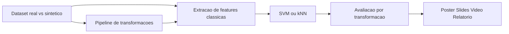

# Detecção de Imagens Sintéticas após Transformações

Trabalho final da disciplina **INE410159 / TRV410001 — Visão Computacional** (UFSC, 2026.2).

---

## Objetivo

Avaliar a **robustez** de detectores de imagens geradas por IA quando essas imagens passam por transformações comuns de compartilhamento digital (compressão, crop, resize, screenshot, filtros etc.).

## Documentação do código

Uma explicação didática, célula por célula, das técnicas, finalidades, limitações e formas de aumentar a acurácia está em [`Cod/EXPLICACAO_MAIN.md`](Cod/EXPLICACAO_MAIN.md).

## Pergunta de pesquisa

> Quão robustos são detectores de imagens sintéticas quando a imagem sofre transformações típicas de circulação na internet?

## Contexto e aplicações reais

| Cenário | O que acontece | Por que importa |
|---|---|---|
| **Política em período eleitoral** | Fotos de candidatos são manipuladas ou geradas por IA e compartilhadas em redes sociais (WhatsApp, Instagram, X) | Desinformação visual influencia eleitores; a imagem raramente chega intacta — passa por crop, compressão e repostagens |
| **Venda de imóveis** | Anúncios alteram fotos do imóvel (cores, iluminação, remoção de defeitos, ampliação de cômodos) para parecer mais atrativo | Comprador decide com base em imagem enganosa; transformações escondem sinais de edição |

Esses casos motivam o foco em **robustez**: a imagem que o detector recebe quase nunca é a original — é uma versão já transformada pela circulação digital ou pela intenção de manipulação.

## Testes preliminares

Os exemplos em [`Exemplos/`](Exemplos/) foram testados com o **[ZeroGPT AI Image Detector](https://www.zerogpt.com/pt/ai-image-detector)** para ilustrar como transformações afetam detectores existentes.

| Etapa | Ferramenta | Papel |
|---|---|---|
| Testes exploratórios | [ZeroGPT](https://www.zerogpt.com/pt/ai-image-detector) | Screenshots de referência (`GeradaIA/`, `EditadaIA/`) |
| Trabalho final | Visão clássica (FFT, HOG, LBP + SVM) | Detector próprio implementado no código |

## Ideia do projeto

Em vez de apenas treinar um classificador "real vs IA", este trabalho é um **experimento científico de robustez**:

1. Obter imagens reais e sintéticas (geradas por IA).
2. Treinar classificador clássico (SVM/kNN) com features extraídas das imagens originais.
3. Aplicar transformações sistemáticas em cada imagem.
4. Medir como a performance degrada a cada transformação.

Isso permite discutir **degradação do espaço de características**, **generalização** e **reconhecimento de padrões** — temas centrais da disciplina.

## Abordagem (Visão Clássica)

Paradigma alinhado ao conteúdo da disciplina: **extrair features manualmente** e classificar com **SVM ou kNN**.



| Etapa | O que fazemos |
|---|---|
| Features | Extrair descritores clássicos (FFT, HOG, LBP, histograma) |
| Baseline | Treinar SVM/kNN em imagens **sem** transformação |
| Transformações | Aplicar crop, JPEG, resize, blur etc. de forma controlada |
| Comparação | Medir queda de acurácia por transformação **e por tipo de feature** |
| Análise | Identificar quais padrões visuais desaparecem após cada transformação |

## Transformações planejadas

| Categoria | Transformações |
|---|---|
| Compressão | JPEG 90%, 70%, 50% |
| Geometria | Resize, crop 10%, 25%, 40% |
| Captura | Screenshot simulado |
| Filtros | Blur, sharpen, brilho/contraste |
| Pipeline | Combinação crop → resize → JPEG |

## Features e classificador

| Domínio (aula) | Features planejadas | O que capturam |
|---|---|---|
| **Frequência** | FFT / espectro de magnitude | Padrões que o JPEG tende a destruir |
| **Espaço** | HOG, bordas (Sobel/Canny) | Gradientes e estrutura local |
| **Valor / textura** | LBP, GLCM, histograma RGB/HSV | Textura e distribuição de intensidade |

| Escopo | Descrição |
|---|---|
| **Mínimo** | 2 tipos de feature + **SVM** (ou kNN) |
| **Recomendado** | Comparar robustez entre famílias de features (ex.: FFT vs HOG vs LBP) |
| **Opcional** | Comparar visão clássica vs 1 CNN simples (tópico clássica vs DL da disciplina) |

## Conexão com a disciplina

| Conceito da aula | Onde aparece no trabalho |
|---|---|
| Domínio do valor | Histograma, LBP, GLCM |
| Domínio do espaço | Convolução, HOG, bordas |
| Domínio da frequência | FFT / DFT |
| Métricas e classificadores | SVM, kNN, distância Euclidiana |
| Reconhecimento de padrões | Análise de degradação do espaço de features |

## Entregas

Prazo final: **30/11/2026** (todas as entregas no mesmo dia) · Detalhes em [`Entregas.md`](Entregas.md)

| # | Entrega | Formato | Tarefas |
|---|---|---|---|
| 1 | Relatório | PDF, 10–20 páginas (+ poster anexo) | [`tarefas/01-relatorio.md`](tarefas/01-relatorio.md) |
| 2 | Código | ZIP do GitHub + modelos treinados (`.pkl`) | [`tarefas/02-codigo.md`](tarefas/02-codigo.md) |

> O Moodle menciona "checkpoint de rede neural", mas como usamos **visão clássica**, enviem os modelos SVM/kNN salvos em `models/` (`.pkl`) e indiquem o caminho no README.
| 3 | Slides | PPTX/ODP + Google Slides | [`tarefas/03-slides.md`](tarefas/03-slides.md) |
| 4 | Vídeo | MP4 H.265 FHD + YouTube | [`tarefas/04-video.md`](tarefas/04-video.md) |
| 5 | Poster | PDF A1, 2 colunas | [`tarefas/05-poster.md`](tarefas/05-poster.md) |

Ordem recomendada de execução: **código → poster → slides → vídeo → relatório** (ver [`tarefas/README.md`](tarefas/README.md)).

## Datas importantes

| Data | Marco |
|---|---|
| 30/11/2026 | Entrega de **todas** as 5 atividades no Moodle (relatório, código, slides, vídeo e poster) |

## Regras de IAGen

Se usar IA generativa para código (Copilot, Cursor, ChatGPT etc.):

- Declarar explicitamente o uso.
- Informar qual ferramenta e quais prompts foram usados.
- Explicar o código gerado para demonstrar compreensão.

Registrar em `IAGEN.md` (criar quando aplicável).

## Referências iniciais

**Visão clássica e detecção:**
- Gonzalez & Woods — *Digital Image Processing* (material da disciplina)
- [Detecting Compressed AI-Generated Images via Phase Spectrum Robustness (CVPR 2026)](https://openaccess.thecvf.com/content/CVPR2026/html/Li_Detecting_Compressed_AI-Generated_Images_via_Phase_Spectrum_Robustness_CVPR_2026_paper.html) — inspiração para análise em frequência
- [Bridging the Gap Between Ideal and Real-world Evaluation (ICCV 2025)](https://openaccess.thecvf.com/content/ICCV2025/html/Li_Bridging_the_Gap_Between_Ideal_and_Real-world_Evaluation_Benchmarking_AI-Generated_ICCV_2025_paper.html) — robustez a transformações

**Comparação (opcional):**
- [Raising the Bar of AI-generated Image Detection with CLIP (CVPR 2024)](https://openaccess.thecvf.com/content/CVPR2024W/WMF/papers/Cozzolino_Raising_the_Bar_of_AI-generated_Image_Detection_with_CLIP_CVPRW_2024_paper.pdf)

## Estrutura prevista do repositório

```
DeteccaoImagensSinteticas/
├── data/              # datasets (não versionar arquivos grandes)
├── src/
│   ├── features/      # extratores clássicos (FFT, HOG, LBP...)
│   ├── transforms/    # pipeline de transformações
│   ├── classifier.py  # SVM / kNN
│   └── evaluate.py    # métricas por transformação
├── models/            # classificadores treinados (.pkl)
├── notebooks/         # experimentos exploratórios
├── results/           # métricas, gráficos, CSVs
├── tarefas/           # checklist por entrega
├── Entregas.md        # requisitos do Moodle
├── IAGEN.md           # registro de uso de IA (se aplicável)
└── README.md
```
